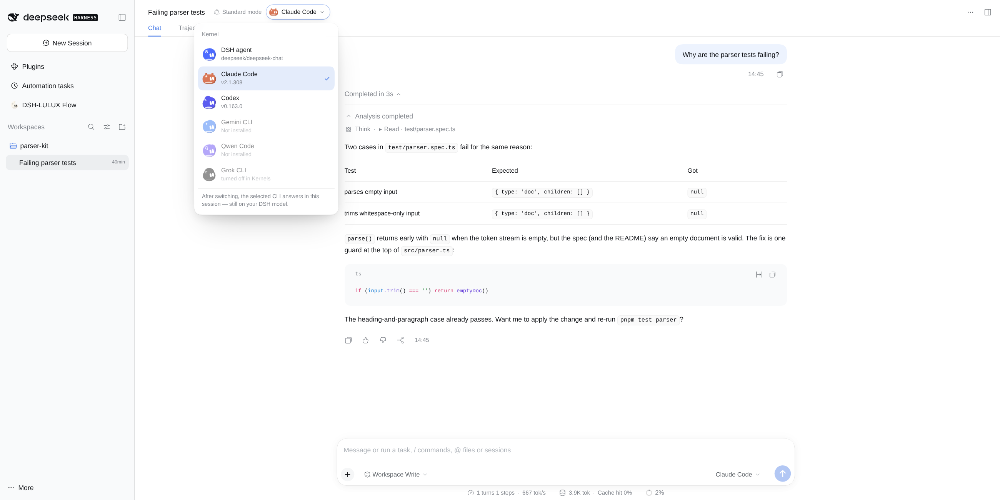
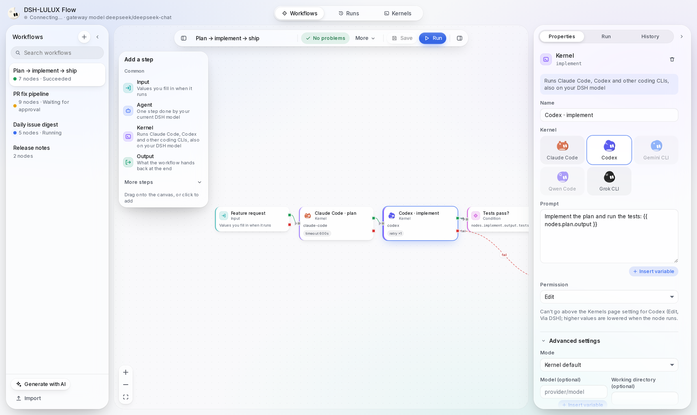
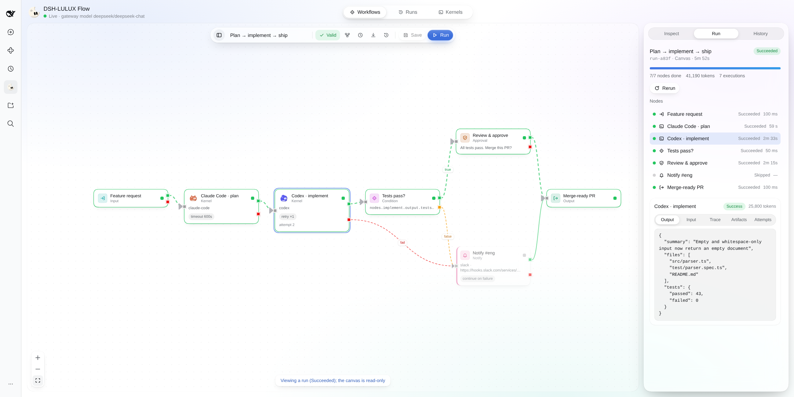
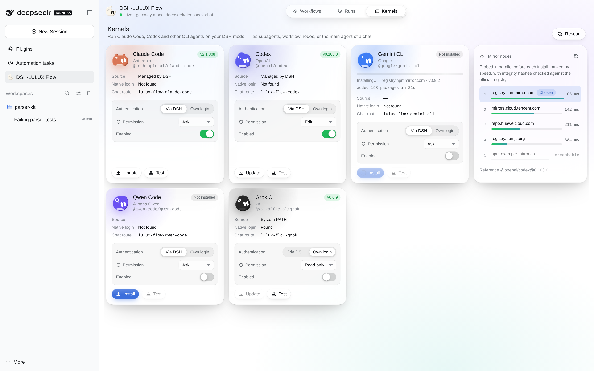

<div align="center">


# DSH-LULUX Flow

**Run Claude Code, Codex, Gemini CLI, Qwen Code and Grok CLI on the models you already configured in DSH — no CLI logins, provider keys never passed to the CLI — and wire them into DAG workflows.**

English · [简体中文](README_zh.md)

[](https://github.com/koko2376/dsh-lulux-flow/actions/workflows/ci.yml)
[](LICENSE)


</div>

> Unofficial community project, independently developed and maintained. Not affiliated with DeepSeek, Anthropic, OpenAI, Google, Alibaba or xAI.



<table>
<tr>
<td width="50%"></td>
<td width="50%"></td>
</tr>
<tr>
<td align="center">Workflow canvas</td>
<td align="center">Run inspector</td>
</tr>
</table>

## Why

You configured your providers in DeepSeek Harness once: DeepSeek, a relay, a
local model, whatever you use. Coding CLIs each want their own login, their own
API key and their own billing. DSH's official Claude Code and Codex subagents
keep that native login model, so every CLI is one more account and one more
place a key lives.

DSH-LULUX Flow puts a small gateway inside DSH. Each CLI is started with a
run-scoped token that only works against that gateway, and the gateway forwards
every call to the model DSH is already using. Provider keys are never passed to
the CLI (not in its environment, arguments or config), and you do not log in to
anything. The CLI still runs as your OS user, so it can read files your user can
read; see [Security model](#security-model). Then you can use those CLIs as your chat
agent, as subagents, or as nodes in a workflow next to DSH's own agents.

## Features

### Scoped gateway: CLIs without logins

- **Five CLIs**: Claude Code, Codex, Gemini CLI, Qwen Code and Grok CLI.
- **One gateway, four wire formats**: Anthropic Messages, OpenAI Chat
  Completions, OpenAI Responses and Gemini, all translated to DSH's model
  runtime. Streaming, tool calls and token usage are carried through.
- **Keys are never passed to the CLI**: the CLI's environment is built from an
  allowlist, each run gets a private config directory, and the only credential
  LULUX Flow hands it is a run-scoped token that is revoked when the run ends.
  The CLI runs as your OS user and can read what your user can read; use an OS
  sandbox or a separate user for untrusted repositories.
- **Use a CLI as the chat agent**: pick it in the session header's kernel
  picker, or select `lulux-flow-<cli>/default` in DSH's model picker. Claude
  Code and Codex resume their native sessions between turns.
- **Subagents**: providers `lulux-flow-claude-code`, `lulux-flow-codex`,
  `lulux-flow-gemini-cli`, `lulux-flow-qwen-code`, `lulux-flow-grok` register
  next to DSH's own, with optional `lulux_flow_subagent_*` tools.
- **Permissions you choose**: `read-only`, `ask`, `edit` or `full`, mapped to
  each CLI's own flags ([per-CLI table](docs/kernels.md)). The Kernels page
  setting is a ceiling: a workflow node can ask for less, never more. Claude
  Code permission prompts appear as DSH approvals.
- **Global mode** per CLI when you do want its native login.
- **Kernel manager**: detects installed CLIs and versions and installs missing
  ones into the plugin's data directory. The dependency tree is resolved
  against registry.npmjs.org first; tarballs then come from the fastest mirror
  and every one is checked against that lockfile before any install script
  runs.

### Workflow canvas

- DAG editor in DSH Web with ten node types: `input`, `output`,
  `agent` (a DSH agent), `kernel` (a CLI), `script`, `http`, `condition`,
  `loop`, `approval` and `notify`.
- **Describe it, get a graph**: "Generate with AI" drafts a workflow from one
  sentence, then lints it.
- Success/failure and true/false edges, retries with backoff, timeouts,
  continue-on-failure, concurrency limits and token / node-run budgets.
- Triggers: the canvas, chat (model tools), cron schedules and signed webhooks.
- **Review before run**: workflows written by the chat model, generated with AI
  or imported start as *unreviewed* and do not run until you approve them in
  the canvas (or approve a single run in DSH's approval dialog).
- Run inspector with per-node input, output, trace and token usage; run
  history, cancel, resume after a restart, and re-run.

### Engineering and security

- Loopback-only gateway with Host/Origin checks; hashed, run-scoped tokens.
- HMAC-signed webhooks with a replay window; CSRF header on the HTTP API.
- SSRF guard on HTTP/notify nodes; credentials are dropped on cross-origin
  redirects; secret-named fields are redacted in run records and tool output.
- Script nodes are off by default and can only be enabled in the plugin config.
- TypeScript strict mode, unit and integration tests, CI on Linux, macOS and
  Windows. See [SECURITY.md](SECURITY.md) and [docs/verification.md](docs/verification.md).

## Install

Requires DeepSeek Harness `>=0.2.1-rc.2 <0.3.0` and Node.js `>=22.15.0`.

```bash
# from GitHub
dsh plugin --profile web add github:koko2376/dsh-lulux-flow

# or from npm
dsh plugin --profile web add dsh-lulux-flow
```

Use `--profile desktop` for DSH Desktop. Restart DSH afterwards;
**DSH-LULUX Flow** appears in the sidebar and in Settings.

**Build allowance (GitHub installs).** The built files are not committed, so a
GitHub install compiles them through the package's `prepare` script. If pnpm
stops with a message that a dependency declares `prepare` / needs
`allowBuilds`, add the names it reports to your profile's
`pnpm-workspace.yaml` (e.g. `~/.dsh/profiles/web/pnpm-workspace.yaml`) and
install again:

```yaml
allowBuilds:
  dsh-lulux-flow: true
  esbuild: true
```

Allowing a build runs that package's scripts on your machine; pin a tag or
commit (`github:koko2376/dsh-lulux-flow#v0.1.1`) if you want a fixed source.
The npm package ships prebuilt files and needs no build.

The CLIs themselves are optional: install the ones you want from the
**Kernels** page, or point a kernel at an existing binary in Settings.

## Quick start

### 1. A CLI as your chat agent

1. Open a chat session in DSH Web.
2. In the session header, open the kernel picker and choose **Claude Code**
   (or Codex, Gemini CLI, Qwen Code, Grok CLI).
3. Send a message. The CLI works in the session's working directory and its
   model calls go to your DSH model. Choose **DSH agent** to switch back.



### 2. A workflow

1. Open **DSH-LULUX Flow** from the sidebar → **Workflows** → **New workflow**,
   or **Generate with AI** and describe the job.
2. Drag in an `input`, one or more `kernel` / `agent` nodes and an `output`;
   connect them. Prompts can reference earlier results with templates such as
   `{{ inputs.topic }}`.
3. **Run**, then watch each node in the run inspector.
4. Optional: add a cron schedule or enable the webhook under **Triggers**.

The same workflows are available to the chat model through the
`lulux_flow_workflow_*` tools. A workflow the model creates or changes, one
generated with AI, and one you import is marked **unreviewed**: open it, check
the nodes, and click **Approve** before it can run from any trigger. When the
model starts a run of an unreviewed workflow, or of one with `edit`/`full`
CLIs, script, HTTP or notify nodes, DSH's approval dialog asks you first. The
model cannot approve approval nodes.

## Works with ds-bot

[ds-bot](https://www.npmjs.com/package/ds-bot) (DS Bot, 0.2.x) lists every
model DSH serves, so the CLIs appear as **Bot models**
(`lulux-flow-claude-code/default`, …) once both plugins are installed. Pick
one for a Bot in its settings or the Create Bot form; nothing else is needed.

- **Best as working members, not as the Main Bot.** A CLI Bot answers direct
  messages, group turns (`@Name`, `[PASS]`), requests from other Bots and
  handoffs with its own tools in its own folder, but it does not get DS Bot's
  tools (`message_bot`, `ask_user`, `update_group`, …), so keep a DSH model on
  the Main Bot and on group admins. In a group, a CLI member calls on another
  member by writing `@Name`.
- The Bot's name, role, instructions and team rules reach the CLI as extra
  system instructions (Claude Code: `--append-system-prompt-file`; Codex:
  developer instructions; other CLIs: on top of a new session's prompt). DS
  Bot's memory summaries, `/btw` side questions (ds-bot 0.2.1) and other
  one-shot calls on a CLI Bot's model go to the gateway model instead of
  starting the CLI: a side question is answered from the chat so far and stays
  out of the CLI's own session. Images are read into text by
  DS Bot's image reader first, because the CLI routes declare text-only input.
- **Long tasks:** DS Bot gives a group turn about 4 minutes. A CLI task that
  runs longer shows "(no answer)" first; its result is posted to the group
  when the CLI finishes.
- **Permission:** use `read-only` or `auto`-style levels (`edit`) for CLIs
  used in groups; with `ask`, approval prompts appear in the member's hidden
  group session.
- Several members can start CLIs at once. `kernelMaxConcurrent` (all CLIs,
  default 6) and `kernelMaxConcurrentPerCli` (each CLI, default 3) cap them;
  extra runs wait in a queue and show one "Queued" line until they start.
  Stopping a queued member removes it from the queue without starting its CLI.

## Configuration

**In the UI (Settings → DSH-LULUX Flow)**, stored per user in
`<data dir>/settings.json`:

| Setting | Default | Meaning |
|---|---|---|
| Language / 语言 | 中文 (`zh-CN`) | Language of the plugin's UI and of the text it puts in DSH's approval dialog: 中文 or English. Independent of DSH's own language; switching applies at once. |
| Gateway model | empty | `provider/model` that CLI traffic goes to. Empty follows DSH's default model; if that is itself a CLI route, the last real model seen for the profile is used. CLI routes are refused here. |
| Per CLI: enabled | on | Show and allow this CLI. |
| Per CLI: mode | `scoped` | `scoped` uses the gateway and no login; `global` uses the CLI's own login and environment. |
| Per CLI: permission | `ask` | `read-only`, `ask`, `edit` or `full` (Grok CLI: no `edit`). Also the ceiling for workflow nodes; unattended runs treat `ask` as `read-only`. |
| Per CLI: binary path | auto | Explicit executable (`.exe`, `.cmd`, a script; surrounding quotes are ignored); empty searches the plugin's install dir, `PATH` and the CLIs' usual install locations. This path is executed (also for `--version`), so only point it at programs you trust. |
| Registry override | auto | npm mirror for CLI tarballs (`https://` only; `http://` only for 127.0.0.1/localhost); empty probes the defaults and picks the fastest. |
| Trust mirror | off | Allow installs when registry.npmjs.org is unreachable. Off: the install is refused, because the lockfile must come from npmjs.org. On: the mirror's own metadata is trusted for the whole tree. |
| Check for updates automatically | plugin config (on) | Check GitHub Releases shortly after start and then daily, and show a small notice when a newer version exists. |
| Update source | plugin config (auto) | `auto` picks the fastest node, `official` asks GitHub only, `mirror` asks the jsDelivr mirrors only (for networks that cannot reach GitHub). |

**Deployment defaults** live in the plugin row of your profile's
`cordis.patch.yml` (`id: dsh-lulux-flow`). Patch layers replace a row's
`config` as a whole, so restate every field you set.

| Field | Default | Meaning |
|---|---|---|
| `dataDir` | `<DSH home>/dsh-lulux-flow` | Workflows, runs, settings, installed CLIs |
| `allowScriptNodes` | `false` | The only switch for script nodes. Not a sandbox: a script node runs code as your OS user (separate Node process, no file system or child processes, but network access) |
| `scriptTimeoutMs` / `scriptMaxHeapMb` | `5000` / `64` | Script node limits |
| `gatewayMaxBodyMb` | `32` | Max request body on the gateway |
| `gatewayRequestTimeoutMs` | `600000` | Upstream deadline per gateway request |
| `kernelTimeoutMs` | `1800000` | Max duration of one CLI run |
| `registerChatRoutes` | `true` | Add `lulux-flow-<cli>/default` model routes |
| `registerSubagentProviders` | `true` | Register `lulux-flow-<cli>` subagent providers |
| `registerTools` | `true` | Register `lulux_flow_*` model tools |
| `allowPrivateHosts` | `[]` | Hosts HTTP/notify nodes may reach even if private |
| `outboundMaxResponseKb` / `outboundTimeoutMs` | `2048` / `30000` | HTTP/notify node limits |
| `registries` | npmjs, npmmirror, Tencent, Huawei | Candidate npm registries for CLI installs |
| `registryProbeTimeoutMs` / `registryCacheTtlMs` | `4000` / 6 h | Mirror probing |
| `installTimeoutMs` | 15 min | CLI install timeout |
| `defaultConcurrency` | `4` | Parallel nodes per run |
| `maxRunsPerWorkflow` | `200` | Run history kept per workflow |
| `modelObserveIntervalMs` | `5000` | How often DSH's default model is sampled |
| `defaultRunDeadlineMs` | 6 h | Wall-clock limit for a run whose workflow sets none (`0` = none) |
| `maxActiveRuns` | `16` | Runs executing at once; further starts are refused |
| `kernelEnvPassthrough` | `[]` | Extra variable names passed to scoped CLIs, e.g. `SSH_AUTH_SOCK` for git over SSH. Anything listed is visible to the CLI |
| `kernelMaxConcurrent` | `6` | CLI runs at once across all CLIs (chat sessions, ds-bot members, workflows, subagents); further runs wait in a FIFO queue |
| `kernelMaxConcurrentPerCli` | `3` | CLI runs at once of any one CLI; further runs of that CLI wait in the queue |
| `updateAutoCheck` | `true` | Check for a newer release about 90 s after start, then daily (the UI setting overrides this) |
| `updateSource` | `auto` | `auto`, `official` (GitHub only) or `mirror` (jsDelivr only); the UI setting overrides this |
| `updateMirrors` | fastly / gcore / testingcf / cdn `.jsdelivr.net` | jsDelivr-compatible `https://` mirrors asked for the latest version number |

The subagent tools (`lulux_flow_subagent_claude_code`, …) are separate rows in
the same file and are **off by default**. Enable one with:

```yaml
- id: lulux-flow-subagent-claude-code
  disabled: false
```

### Update check

The plugin tells you when a newer version is on
[GitHub Releases](https://github.com/koko2376/dsh-lulux-flow/releases); it
never downloads or installs anything. A small **New x.y.z** badge appears at
the top right of the LULUX Flow page; it shows the current and latest
version, a short summary of the release notes and three buttons: **View
release** (opens the GitHub release page), **Remind later** (hides it for a
day) and **Skip this version** (hides it until a newer version comes out).
**More → Check for updates** in the canvas toolbar, or the button under
Settings → Updates, checks right away and reports "up to date", "new version"
or "check failed".

To serve every network, the first check asks GitHub (`api.github.com`,
`github.com`) and several jsDelivr mirrors in parallel with a 4 s timeout and
keeps the fastest one for later checks; if both answer, GitHub's answer wins.
The system time zone only breaks near-ties. Mirrors only supply a version
number, and the link always points to github.com. See
[SECURITY.md](SECURITY.md#hosts-the-plugin-contacts) for every host contacted.

## Security model

- **Keys.** Provider keys are never passed to the CLI: not in its environment,
  arguments or config files. Scoped mode builds the CLI's environment from an
  allowlist (`PATH`, `HOME`, locale, terminal, temp dirs, Windows system
  variables, proxies without credentials, plus `kernelEnvPassthrough`).
- **What that does not cover.** The CLI runs as your OS user, so it can still
  read files your user can read, including DSH's own configuration and, on
  Linux, other processes' `/proc/<pid>/environ`. LULUX Flow narrows this where
  the CLI supports it (Claude Code gets deny rules for the DSH home, the plugin
  data directory and `/proc`; Codex tool commands get only a core environment
  and no network below `full`), but that is not an OS sandbox. **For untrusted
  repositories, run DSH in an OS sandbox or as a separate user.**
- The gateway listens on `127.0.0.1` only, checks the `Host` header and
  refuses browser requests (any `Origin` header).
- Every CLI run gets a random run-scoped token bound to that run, model and
  protocol. Only its hash is stored in the gateway; it expires and is revoked
  when the run ends.
- Workflow nodes cannot raise a CLI's permission or mode above the Kernels page
  setting, and privilege fields cannot be templated. Model-written, generated
  and imported workflows need your approval before they run.
- The canvas API requires your DSH session plus a CSRF header. Webhooks need an
  HMAC-SHA256 signature with a ±5 minute timestamp window and replay check.
- HTTP/notify nodes block private and metadata addresses, re-checked at connect
  time and on every redirect; credentials are dropped when a redirect changes
  origin.
- Script nodes are opt-in in the plugin config and are **not** a sandbox.

Full threat model, residual risks and reporting: [SECURITY.md](SECURITY.md).

## Architecture

```mermaid
flowchart LR
  subgraph Browser["DSH Web"]
    UI["Canvas · Runs · Kernels · Settings<br/>session kernel picker"]
  end
  subgraph Host["DSH host process"]
    API["HTTP API<br/>/dsh-lulux-flow/api"]
    ENG["Workflow engine<br/>cron · webhooks · approvals"]
    ROUTES["Model routes<br/>lulux-flow-&lt;cli&gt;/default"]
    SUB["Subagent providers<br/>lulux-flow-&lt;cli&gt;"]
    RUN["Kernel runner<br/>scrubbed env · private home"]
    GW["Scoped gateway 127.0.0.1<br/>Anthropic · OpenAI Chat/Responses · Gemini"]
    LLM["ctx.llm<br/>your DSH providers + keys"]
  end
  CLI["Claude Code · Codex · Gemini CLI<br/>Qwen Code · Grok CLI"]
  UP["Model provider"]

  UI --> API --> ENG
  ENG --> RUN
  ROUTES --> RUN
  SUB --> RUN
  RUN -- "spawn + run-scoped token" --> CLI
  CLI -- "vendor wire format + token" --> GW
  GW --> LLM --> UP
  ENG -- "agent nodes" --> LLM
```



## How it compares

A factual summary based on each project's own README at the time of writing.
All of them are good at what they set out to do; they mostly solve different
problems, and several can be installed side by side.

| Project | What it is | Runs external coding CLIs | CLI credentials | Visual DAG editor | Triggers | License |
|---|---|---|---|---|---|---|
| **DSH-LULUX Flow** | Scoped gateway for five CLIs + workflow canvas | Claude Code, Codex, Gemini CLI, Qwen Code, Grok CLI | None needed in scoped mode (DSH's model and keys); native login optional | Yes | Canvas, chat tools, cron, webhook | Apache-2.0 |
| [@deepseek-ai/dsh-subagent-claude-code](https://www.npmjs.com/package/@deepseek-ai/dsh-subagent-claude-code) / [-codex](https://www.npmjs.com/package/@deepseek-ai/dsh-subagent-codex) | Official one-shot subagent providers | Claude Code / Codex (bundled, pinned runtime) | Native CLI login and settings; API keys passed via `env` | — | Model delegation | BSD-3-Clause |
| [Workflow One](https://github.com/chumingjun/dsh-harness-one) | Visual workflow orchestrator for DSH agents | Not described | — | Yes (agent, script, condition, HTTP, notify nodes) | Canvas, chat, webhook, cron; Feishu delivery | MIT |
| [omdsh-dev/dsh_workflow](https://github.com/omdsh-dev/dsh_workflow) | Saved, resumable workflow layer (`/workflow` commands, capsules) over DSH subagents | Not described | — | No (code-defined capsules) | Commands, model tools | MIT |
| [GZX2211/dsh-Visual-Workflow](https://github.com/GZX2211/dsh-Visual-Workflow) | Visual agent orchestration platform: meta-orchestration, agent teams, MCP, human-in-the-loop | Not described | — | Yes | Canvas, scheduled tasks, API service mode | MIT |
| [xuanyuanzhifeng/dsh-plugin-agent-workflow](https://github.com/xuanyuanzhifeng/dsh-plugin-agent-workflow) | Read-only "Workflow" tab that visualises a session's model and tool calls | No | — | No (execution timeline view) | — | MIT |

"Not described" means the project's README does not mention it, not that it is
impossible. Corrections are welcome via an issue.

## FAQ

**Do I need a Claude, OpenAI, Google, Qwen or xAI account?**
Not in scoped mode. The CLI talks to the plugin's gateway, which uses the model
you configured in DSH. You still need the CLI binary (the Kernels page can
install it).

**Which model does the CLI actually use?**
The **Gateway model** if you set one, otherwise DSH's default model. The CLI's
own model names (`sonnet`, `gpt-5`, …) are mapped onto that model.

**Will the CLI behave exactly like with its vendor's model?**
The CLI's tools, prompts and workflow are unchanged, but quality depends on
the model behind the gateway. A model with solid tool calling works best.

**Can a web page or another program on my machine use the gateway?**
Browsers are refused outright, and other local programs need a valid run token.
It is given only to the CLI process (environment, and for Claude Code a 0600
file in its per-run home) and is revoked when the run ends. A program running
as your own user could read it during the run; see [SECURITY.md](SECURITY.md).

**Can the CLI read my provider keys?**
They are never passed to it. But a CLI runs as your OS user, so it can read any
file your user can read, including DSH's configuration. Claude Code gets deny
rules for those paths; other CLIs do not have path rules. Use an OS sandbox or
a separate user for repositories you do not trust.

**Does the CLI get DSH's tools or MCP servers?**
No. The CLI runs its own tools. DSH sees its activity as reasoning lines and
its final answer as the reply.

**Where is my data?**
`~/.dsh/dsh-lulux-flow/` by default: workflows, runs, settings, chat-session
bindings and CLIs installed by the plugin. Nothing is sent anywhere except
through your DSH providers and the HTTP/notify nodes you add.

**How do I sign a webhook?**
`X-Lulux-Flow-Timestamp: <unix seconds>` and
`X-Lulux-Flow-Signature: sha256=<hex HMAC-SHA256 of "<timestamp>.<raw body>">`
using the secret shown once when you enable the webhook (enabling again rotates it).

## Known limitations

- **Images are dropped when forwarding.** The gateway forwards text to DSH's
  model runtime; inline images from a CLI are replaced by a placeholder, and
  remote image URLs are never fetched.
- **Gemini CLI, Qwen Code and Grok CLI replay context** instead of resuming a
  native session, so long chats resend history on each turn. Claude Code and
  Codex resume natively.
- **Windows CLI launch is best-effort.** npm `.cmd` shims are resolved to the
  program they start: native executables (such as Claude Code's `claude.exe`)
  run directly, JavaScript entries run with Node (or, if neither can be
  resolved, through `cmd.exe` with escaped arguments). Shim parsing and
  quoting have unit tests; launching each CLI on Windows has not been
  verified end-to-end.
- **Node.js inside DSH Desktop.** DSH Desktop's own executable is not Node.js.
  CLIs whose entry is a JavaScript file (Codex's launcher, Gemini CLI, Qwen
  Code, Grok CLI on Windows), script nodes and CLI installs use a Node.js 20+
  found on `PATH` (or in its usual install location). Without one, DSH Desktop
  is run as Node.js when the app allows it; otherwise the Kernels page says so
  and nothing is started. Installing Node.js 22+ avoids this.
- **Grok CLI has no `edit` level**: it has no "edit files but no shell" mode,
  so only `read-only`/`ask` (read tools) and `full` are offered.
- Only Claude Code bridges permission prompts to DSH approvals; the other CLIs
  use their own sandbox / approval flags.
- DSH's own tools are not offered to a CLI running as the chat agent.
- Gemini CLI, Qwen Code and Grok CLI were tested with adapter tests, not yet
  against their real binaries. See [docs/verification.md](docs/verification.md).
- DSH is pre-release; a future DSH release may need a matching plugin update.

## Disclaimer

DSH-LULUX Flow is an unofficial community project. It is not affiliated with,
endorsed by or sponsored by DeepSeek, Anthropic, OpenAI, Google, Alibaba or
xAI. Product names such as DeepSeek, Claude Code, Codex, Gemini CLI, Qwen Code
and Grok are trademarks of their respective owners. You are responsible for
complying with the terms of the CLIs and model providers you use.

## Contributing

Issues and pull requests are welcome; see [CONTRIBUTING.md](CONTRIBUTING.md)
(commits need a DCO sign-off) and the [Code of Conduct](CODE_OF_CONDUCT.md).

## License

[Apache License 2.0](LICENSE) © 2026 koko. Third-party notices:
[NOTICE](NOTICE), [THIRD_PARTY_LICENSES.md](THIRD_PARTY_LICENSES.md).
