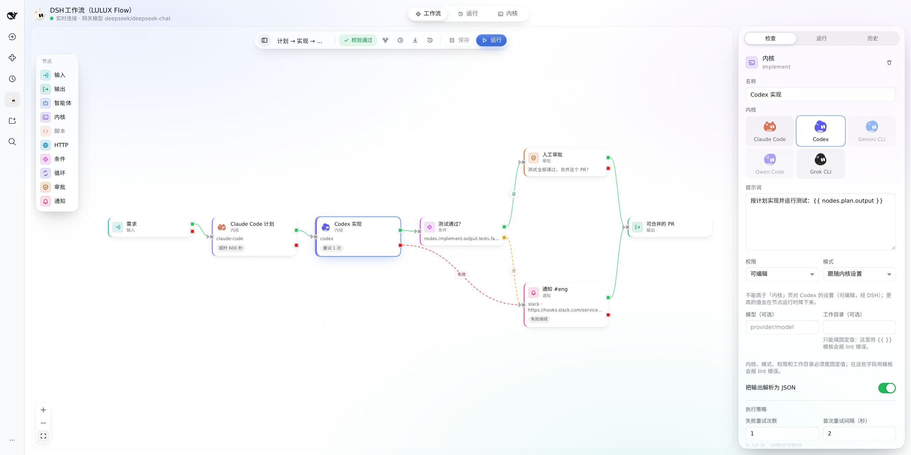
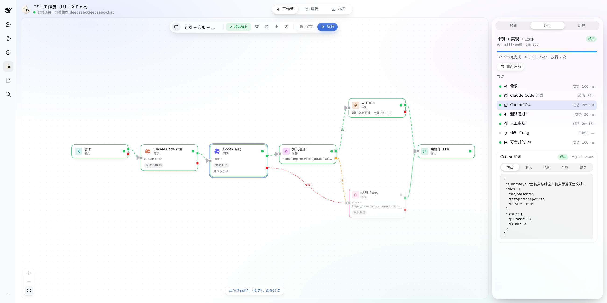
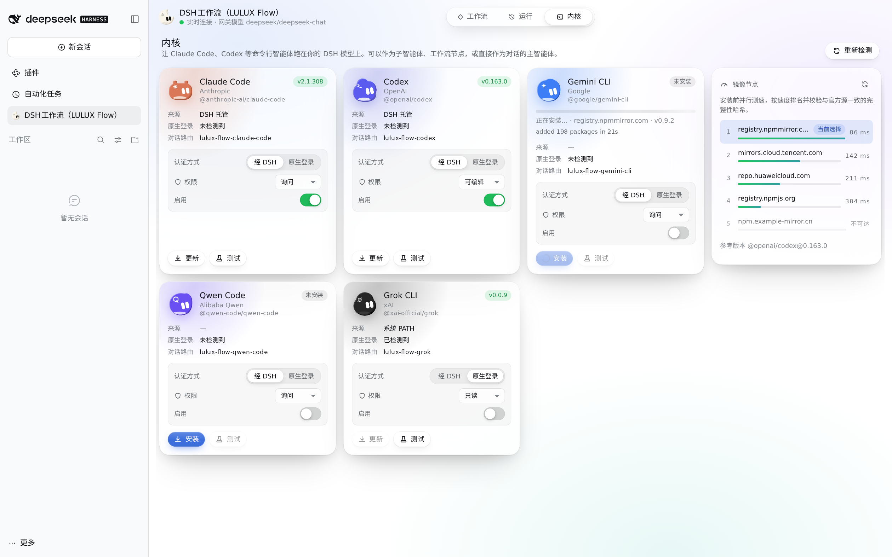
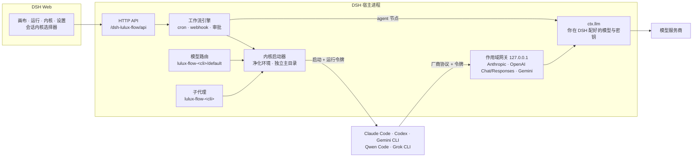

<div align="center">


# DSH工作流（LULUX Flow）

**用你在 DSH 里已经配好的模型，直接跑 Claude Code、Codex、Gemini CLI、Qwen Code 和 Grok CLI —— 不用登录这些 CLI，模型密钥也不会传给 CLI —— 再把它们接成 DAG 工作流。**

[English](README.md) · 简体中文

[](https://github.com/koko2376/dsh-lulux-flow/actions/workflows/ci.yml)
[](LICENSE)


</div>

> 非官方项目，由社区成员独立开发和维护。与 DeepSeek、Anthropic、OpenAI、Google、阿里巴巴、xAI 均无关联。


<table>
<tr>
<td width="50%"></td>
<td width="50%"></td>
</tr>
<tr>
<td align="center">工作流画布</td>
<td align="center">运行详情</td>
</tr>
</table>

## 为什么做这个

模型服务你已经在 DeepSeek Harness 里配过一次了：DeepSeek、中转、本地模型，随你。可每个编程 CLI 都要单独登录、单独的 API Key、单独计费。DSH 官方的 Claude Code / Codex 子代理沿用的也是 CLI 原生登录，于是每多一个 CLI，就多一个账号、多一处放密钥的地方。

DSH工作流（LULUX Flow）在 DSH 进程里放了一个小网关。每个 CLI 启动时只拿到一个按运行签发的令牌（run-scoped token），这个令牌只能访问这个网关；网关再把每次调用转给 DSH 正在用的模型。模型密钥从不传给 CLI（不放进环境变量、命令行参数或配置文件），你也不用登录任何东西。但 CLI 以你的系统用户身份运行，仍能读取该用户能读的文件，详见[安全模型](#安全模型)。接下来，这些 CLI 可以当对话 Agent、当子代理，也可以作为工作流里的节点，和 DSH 自己的 Agent 摆在一起。

## 功能

### 作用域网关：CLI 免登录

- **五个 CLI**：Claude Code、Codex、Gemini CLI、Qwen Code、Grok CLI。
- **一个网关，四种协议**：Anthropic Messages、OpenAI Chat Completions、OpenAI Responses、Gemini，统一转换到 DSH 的模型运行时；流式输出、工具调用和 token 用量都会透传。
- **密钥不传给 CLI**：CLI 的环境变量按白名单构建，每次运行使用独立的配置目录，LULUX Flow 交给它的唯一凭据是运行结束即吊销的令牌。CLI 以你的系统用户身份运行，能读你能读的文件；不可信的仓库请放进系统沙箱或用单独的系统用户运行。
- **CLI 当对话 Agent**：在会话顶部的内核选择器里选它，或在 DSH 模型选择器里选 `lulux-flow-<cli>/default`。Claude Code 和 Codex 在多轮之间续用原生会话。
- **子代理**：`lulux-flow-claude-code`、`lulux-flow-codex`、`lulux-flow-gemini-cli`、`lulux-flow-qwen-code`、`lulux-flow-grok` 注册在 DSH 官方子代理旁边，并可选开启 `lulux_flow_subagent_*` 工具。
- **权限由你定**：`read-only`、`ask`、`edit`、`full`，映射到各 CLI 自己的参数（[各 CLI 对照表](docs/kernels.md)）。内核页面的设置是上限：工作流节点只能要求更低的权限，不能更高。Claude Code 的权限请求会以 DSH 审批弹窗出现。
- **全局模式**：某个 CLI 确实想用它自己的登录时，可单独切换。
- **内核管理**：检测已安装的 CLI 与版本，把缺失的安装到插件数据目录；先在 registry.npmjs.org 上解析出完整依赖锁文件，再从最快的镜像下载，每个包都按锁文件里的完整性哈希校验后才会执行安装脚本。

### 工作流画布

- DSH Web 里的 DAG 编辑器，十种节点：`input`、`output`、`agent`（DSH Agent）、`kernel`（CLI）、`script`、`http`、`condition`、`loop`、`approval`、`notify`。
- **一句话出图**：「AI 生成」根据一句描述起草工作流，并自动校验。
- 成功 / 失败、真 / 假分支连线，带退避的重试、超时、失败继续、并发上限，以及 token / 节点执行次数预算。
- 触发方式：画布、对话（模型工具）、cron 定时、签名 Webhook。
- **先审后跑**：对话模型写的、AI 生成的、导入的工作流都标记为「未审核」，你在画布里批准之前不会运行（也可以在 DSH 审批弹窗里只批准一次运行）。
- 运行详情可看每个节点的输入、输出、trace 和 token 用量；运行历史、取消、重启后续跑、重跑。

### 工程与安全

- 网关只监听本机回环地址，校验 Host / Origin；令牌按运行签发、只存哈希。
- Webhook 使用 HMAC 签名并带重放窗口；HTTP API 需要 CSRF 请求头。
- HTTP / 通知节点有 SSRF 防护；跨源重定向时丢弃凭据请求头；运行记录和工具输出里的敏感字段会脱敏。
- 脚本节点默认关闭，只能在插件配置里开启。
- TypeScript 严格模式，单元与集成测试，CI 覆盖 Linux、macOS、Windows。详见 [SECURITY.md](SECURITY.md) 与 [docs/verification.md](docs/verification.md)。

## 安装

需要 DeepSeek Harness `>=0.2.1-rc.2 <0.3.0`、Node.js `>=22.15.0`。

```bash
# 从 GitHub 安装
dsh plugin --profile web add github:koko2376/dsh-lulux-flow

# 或从 npm 安装
dsh plugin --profile web add dsh-lulux-flow
```

DSH 桌面版改用 `--profile desktop`。装完重启 DSH，侧栏和设置里会出现 **DSH工作流（LULUX Flow）**。

**构建许可（GitHub 安装）**：仓库不提交构建产物，从 GitHub 安装时会通过包的 `prepare` 脚本现场编译。如果 pnpm 提示某个依赖声明了 `prepare`、需要 `allowBuilds`，把提示里的包名加到对应 profile 的 `pnpm-workspace.yaml`（如 `~/.dsh/profiles/web/pnpm-workspace.yaml`），再装一次：

```yaml
allowBuilds:
  dsh-lulux-flow: true
  esbuild: true
```

允许构建意味着在你的机器上执行该包的脚本；想固定来源可以锁定标签或 commit（`github:koko2376/dsh-lulux-flow#v0.1.1`）。npm 包自带构建产物，无需构建。

CLI 本身按需安装：在 **内核** 页面一键安装，或在设置里指向已有的可执行文件。

## 快速开始

### 1. 让 CLI 当对话 Agent

1. 在 DSH Web 打开一个会话。
2. 点开会话顶部的内核选择器，选 **Claude Code**（或 Codex、Gemini CLI、Qwen Code、Grok CLI）。
3. 发消息。CLI 在会话的工作目录里干活，模型调用走你在 DSH 配好的模型。选 **DSH 智能体** 即可切回。



### 2. 搭一个工作流

1. 侧栏打开 **DSH工作流（LULUX Flow）** → **工作流** → **新建工作流**，或点 **AI 生成** 描述你要做的事。
2. 拖入 `input`、一个或多个 `kernel` / `agent` 节点和 `output`，连起来。提示词里可以用 `{{ inputs.topic }}` 这样的模板引用前面的结果。
3. 点 **运行**，在运行详情里看每个节点。
4. 可选：在 **触发器** 里加 cron 定时或开启 Webhook。

对话模型也能通过 `lulux_flow_workflow_*` 工具使用同样的工作流。模型新建或修改的、AI 生成的、导入的工作流会标记为**未审核**：打开检查节点，点 **批准** 后才能被任何触发方式运行。模型启动未审核的工作流，或包含 `edit`/`full` CLI、脚本、HTTP、通知节点的工作流时，会先弹出 DSH 审批让你确认。模型不能替你批准审批节点。

## 配合 ds-bot 使用

[ds-bot](https://www.npmjs.com/package/ds-bot)（DS Bot，0.2.x）会列出 DSH 提供的全部模型，所以两个插件都装好后，各个 CLI 会直接出现在 **Bot 模型**里（`lulux-flow-claude-code/default` 等）。在 Bot 设置或新建 Bot 表单里选上即可，不需要其他配置。

- **适合当干活的成员，不适合当 Main Bot。** CLI Bot 能回复私聊、群聊轮次（`@名字`、`[PASS]`）、其他 Bot 的请求和交接，用的是它自己的工具和目录；但它拿不到 DS Bot 的工具（`message_bot`、`ask_user`、`update_group` 等），所以 Main Bot 和群管理员请继续用 DSH 模型。在群里，CLI 成员写 `@名字` 就能点名其他成员。
- Bot 的名字、角色、说明和团队规则会作为附加系统指令交给 CLI（Claude Code 用 `--append-system-prompt-file`，Codex 用 developer instructions，其他 CLI 放在新会话第一条提示的开头）。DS Bot 的记忆整理等一次性调用即使用的是 CLI Bot 的模型，也会改走网关模型，不会启动 CLI。CLI 路由声明只接受文本，因此图片会先由 DS Bot 识别成文字。
- **长任务：** DS Bot 给每个群聊轮次约 4 分钟。超过这个时间的 CLI 任务会先显示“(no answer)”，CLI 完成后结果仍会发到群里。
- **权限：** 群里用的 CLI 建议设为 `read-only` 或自动放行级别（`edit`）；设为 `ask` 时，审批提示会出现在该成员隐藏的群会话里。
- 多个成员可能同时启动 CLI。`kernelMaxConcurrent`（所有 CLI 合计，默认 6）和 `kernelMaxConcurrentPerCli`（每个 CLI，默认 3）限制并发；超出的运行会排队，并显示一行“Queued”状态，开始运行后继续正常输出。停止排队中的成员会把它移出队列，不会启动 CLI。

## 配置

**界面设置（设置 → DSH工作流（LULUX Flow））**，按用户保存在 `<数据目录>/settings.json`：

| 设置 | 默认 | 说明 |
|---|---|---|
| Language / 语言 | 中文（`zh-CN`） | 插件界面及其在 DSH 审批弹窗中所显示文字的语言：中文或 English。与 DSH 自身的语言设置无关，切换后立即生效。 |
| 网关模型 | 空 | CLI 流量要转发到的 `provider/model`。留空则跟随 DSH 默认模型；若默认模型本身是 CLI 路由，则使用该 profile 最近一次见到的真实模型。这里不接受 CLI 路由。 |
| 每个 CLI：启用 | 开 | 显示并允许使用该 CLI。 |
| 每个 CLI：模式 | `scoped` | `scoped` 走网关、免登录；`global` 使用 CLI 自己的登录和环境。 |
| 每个 CLI：权限 | `ask` | `read-only`、`ask`、`edit`、`full`（Grok CLI 没有 `edit`）。同时也是工作流节点的上限；无人值守运行时 `ask` 按 `read-only` 处理。 |
| 每个 CLI：可执行文件路径 | 自动 | 显式指定可执行文件（`.exe`、`.cmd` 或脚本；首尾引号会被忽略）；留空则在插件安装目录、`PATH` 和各 CLI 的常见安装位置中查找。该路径会被执行（包括 `--version`），只指向你信任的程序。 |
| 镜像源覆盖 | 自动 | 下载 CLI 包用的 npm 镜像（只接受 `https://`；`http://` 仅限 127.0.0.1/localhost）；留空则探测默认源并选最快的。 |
| 信任镜像 | 关 | registry.npmjs.org 不可达时是否仍允许安装。关：拒绝安装，因为锁文件必须来自 npmjs.org。开：整棵依赖树都信任镜像自己的元数据。 |
| 自动检查更新 | 跟随插件配置（开） | 启动后稍等片刻检查一次 GitHub Releases，之后每天一次；有新版本时显示一个小提示。 |
| 更新源 | 跟随插件配置（自动） | `auto` 自动选最快的节点，`official` 只问 GitHub，`mirror` 只问 jsDelivr 镜像（适合访问不了 GitHub 的网络）。 |

**部署级默认值** 写在 profile 的 `cordis.patch.yml` 里插件那一行（`id: dsh-lulux-flow`）。patch 层会整体替换该行的 `config`，所以要把你设置的字段全部写上。

| 字段 | 默认 | 说明 |
|---|---|---|
| `dataDir` | `<DSH 主目录>/dsh-lulux-flow` | 工作流、运行记录、设置、已安装的 CLI |
| `allowScriptNodes` | `false` | 开启脚本节点的唯一开关。不是沙箱：脚本节点等同于以你的系统用户身份运行代码（独立 Node 进程，无文件系统和子进程权限，但能访问网络） |
| `scriptTimeoutMs` / `scriptMaxHeapMb` | `5000` / `64` | 脚本节点限制 |
| `gatewayMaxBodyMb` | `32` | 网关请求体上限 |
| `gatewayRequestTimeoutMs` | `600000` | 网关单次上游请求超时 |
| `kernelTimeoutMs` | `1800000` | 单次 CLI 运行最长时间 |
| `registerChatRoutes` | `true` | 注册 `lulux-flow-<cli>/default` 模型路由 |
| `registerSubagentProviders` | `true` | 注册 `lulux-flow-<cli>` 子代理 |
| `registerTools` | `true` | 注册 `lulux_flow_*` 模型工具 |
| `allowPrivateHosts` | `[]` | 允许 HTTP / 通知节点访问的内网主机 |
| `outboundMaxResponseKb` / `outboundTimeoutMs` | `2048` / `30000` | HTTP / 通知节点限制 |
| `registries` | npmjs、npmmirror、腾讯云、华为云 | 安装 CLI 的候选 npm 源 |
| `registryProbeTimeoutMs` / `registryCacheTtlMs` | `4000` / 6 小时 | 镜像探测 |
| `installTimeoutMs` | 15 分钟 | CLI 安装超时 |
| `defaultConcurrency` | `4` | 每次运行的并行节点数 |
| `maxRunsPerWorkflow` | `200` | 每个工作流保留的运行记录数 |
| `modelObserveIntervalMs` | `5000` | 采样 DSH 默认模型的间隔 |
| `defaultRunDeadlineMs` | 6 小时 | 工作流没设截止时间时，单次运行的总时长上限（`0` 表示不限） |
| `maxActiveRuns` | `16` | 同时执行的运行数上限，超出会拒绝启动 |
| `kernelEnvPassthrough` | `[]` | 额外传给作用域模式 CLI 的环境变量名，例如 git over SSH 需要的 `SSH_AUTH_SOCK`。列在这里的变量 CLI 都能看到 |
| `kernelMaxConcurrent` | `6` | 所有 CLI 同时运行的最大数量（聊天会话、ds-bot 成员、工作流、子代理合计），超出的按先后顺序排队 |
| `kernelMaxConcurrentPerCli` | `3` | 单个 CLI 同时运行的最大数量，超出的排队 |
| `updateAutoCheck` | `true` | 启动约 90 秒后检查一次新版本，之后每天一次（界面设置优先） |
| `updateSource` | `auto` | `auto`、`official`（仅 GitHub）或 `mirror`（仅 jsDelivr）；界面设置优先 |
| `updateMirrors` | fastly / gcore / testingcf / cdn `.jsdelivr.net` | 与 jsDelivr 兼容的 `https://` 镜像，只用来读取最新版本号 |

子代理工具（`lulux_flow_subagent_claude_code` 等）是同一文件里的独立行，**默认关闭**。开启示例：

```yaml
- id: lulux-flow-subagent-claude-code
  disabled: false
```

### 检查更新

有新版本发布到 [GitHub Releases](https://github.com/koko2376/dsh-lulux-flow/releases) 时，插件会提示你；它不会自动下载或安装任何东西。提示是 LULUX Flow 页面右上角的一个小标记 **新版本 x.y.z**，点开可以看到当前版本、最新版本和更新内容摘要，以及三个按钮：**查看更新**（打开 GitHub 发布页）、**稍后提醒**（一天内不再显示）、**忽略此版本**（直到出现更新的版本前都不再显示）。画布工具栏的 **更多 → 检查更新**，或 设置 → 更新 里的按钮，会立即检查并提示“已是最新”“有新版本”或“检查失败”。

为了让各地网络都能用，第一次检查会同时询问 GitHub（`api.github.com`、`github.com`）和几个 jsDelivr 镜像，每个最多等 4 秒，之后的检查只用最快的那个；两边都有结果时以 GitHub 为准。系统时区只在速度接近时用来决定先后。镜像只提供版本号，链接始终指向 github.com。插件会连接的全部主机见 [SECURITY.md](SECURITY.md#hosts-the-plugin-contacts)。

## 安全模型

- **密钥**：模型密钥从不传给 CLI，不放进它的环境变量、命令行参数或配置文件。作用域模式按白名单构建 CLI 的环境（`PATH`、`HOME`、语言区域、终端、临时目录、Windows 系统变量、不含账号密码的代理，以及 `kernelEnvPassthrough`）。
- **这不能防住的**：CLI 以你的系统用户身份运行，仍能读取该用户能读的任何文件，包括 DSH 自己的配置，以及 Linux 上其他进程的 `/proc/<pid>/environ`。在 CLI 支持的地方 LULUX Flow 会收窄范围（Claude Code 对 DSH 主目录、插件数据目录和 `/proc` 加了拒绝规则；Codex 在 `full` 以下时工具命令只拿到核心环境变量且不能联网），但这不是系统级沙箱。**处理不可信仓库时，请把 DSH 放进系统沙箱，或用单独的系统用户运行。**
- 网关只监听 `127.0.0.1`，校验 `Host` 头，并拒绝浏览器请求（带 `Origin` 头的一律拒绝）。
- 每次 CLI 运行都会拿到一个与该运行、模型、协议绑定的随机令牌；网关只保存哈希，到期失效，运行结束即吊销。
- 工作流节点不能把 CLI 的权限或模式提高到内核页面设置之上，权限相关字段不能用模板。模型写的、AI 生成的和导入的工作流需要你批准后才能运行。
- 画布 API 需要 DSH 登录态加 CSRF 请求头；Webhook 需要 HMAC-SHA256 签名，时间戳窗口 ±5 分钟，并做重放检查。
- HTTP / 通知节点拦截内网和云元数据地址，在建立连接时和每次重定向时都会重新检查；重定向换源时会丢弃凭据请求头。
- 脚本节点只能在插件配置里开启，且**不是**沙箱。

完整威胁模型、剩余风险与漏洞报告方式见 [SECURITY.md](SECURITY.md)。

## 架构



## 与其他项目对比

以下内容依据各项目撰写本文时的 README 整理。它们在各自目标上都做得很好，解决的问题大多不同，其中不少可以同时安装。

| 项目 | 定位 | 能否运行外部编程 CLI | CLI 凭据 | 可视化 DAG 编辑 | 触发方式 | 许可证 |
|---|---|---|---|---|---|---|
| **DSH工作流（LULUX Flow）** | 五个 CLI 的作用域网关 + 工作流画布 | Claude Code、Codex、Gemini CLI、Qwen Code、Grok CLI | 作用域模式无需凭据（用 DSH 的模型和密钥）；可选原生登录 | 有 | 画布、对话工具、cron、Webhook | Apache-2.0 |
| [@deepseek-ai/dsh-subagent-claude-code](https://www.npmjs.com/package/@deepseek-ai/dsh-subagent-claude-code) / [-codex](https://www.npmjs.com/package/@deepseek-ai/dsh-subagent-codex) | 官方一次性子代理 | Claude Code / Codex（自带固定版本运行时） | CLI 原生登录与设置；API Key 通过 `env` 传入 | — | 模型委派 | BSD-3-Clause |
| [Workflow One](https://github.com/chumingjun/dsh-harness-one) | 面向 DSH Agent 的可视化工作流编排 | 未提及 | — | 有（agent、脚本、条件、HTTP、通知等节点） | 画布、对话、Webhook、cron；飞书推送 | MIT |
| [omdsh-dev/dsh_workflow](https://github.com/omdsh-dev/dsh_workflow) | 基于 DSH 子代理的可保存、可续跑工作流层（`/workflow` 命令、capsule） | 未提及 | — | 无（代码定义的 capsule） | 命令、模型工具 | MIT |
| [GZX2211/dsh-Visual-Workflow](https://github.com/GZX2211/dsh-Visual-Workflow) | 可视化 Agent 编排平台：元编排、Agent Team、MCP、人类在环 | 未提及 | — | 有 | 画布、定时任务、API 服务模式 | MIT |
| [xuanyuanzhifeng/dsh-plugin-agent-workflow](https://github.com/xuanyuanzhifeng/dsh-plugin-agent-workflow) | 只读的「工作流」标签页，可视化会话中的模型与工具调用 | 否 | — | 无（执行链路视图） | — | MIT |

「未提及」指该项目 README 没有提到，不代表做不到。如有出入，欢迎提 Issue 指正。

## 常见问题

**需要 Claude、OpenAI、Google、通义或 xAI 的账号吗？**
作用域模式下不需要。CLI 连的是插件的网关，网关用的是你在 DSH 里配好的模型。CLI 程序本身还是要有（内核页面可以帮你装）。

**CLI 实际用的是哪个模型？**
设置了「网关模型」就用它，否则用 DSH 默认模型。CLI 自己的模型名（`sonnet`、`gpt-5` 等）都会映射到这个模型上。

**CLI 的表现会和接官方模型时一模一样吗？**
CLI 的工具、提示词和工作方式不变，但效果取决于网关背后的模型。工具调用能力扎实的模型效果最好。

**网页或本机其他程序能用这个网关吗？**
浏览器请求会被直接拒绝；本机其他程序需要有效的运行令牌。令牌只交给 CLI 进程（环境变量；Claude Code 另有一份在其独立主目录里的 0600 文件），运行结束即吊销。以你本人用户身份运行的程序在运行期间仍可能读到它，详见 [SECURITY.md](SECURITY.md)。

**CLI 能读到我的模型密钥吗？**
密钥从不传给它。但 CLI 以你的系统用户身份运行，能读取你能读的任何文件，包括 DSH 的配置。Claude Code 对这些路径加了拒绝规则，其他 CLI 没有路径规则。不信任的仓库请用系统沙箱或单独的系统用户。

**CLI 能用 DSH 的工具或 MCP 吗？**
不能。CLI 运行它自己的工具；DSH 把它的活动显示为思考过程，把最终回答作为回复。

**数据存在哪里？**
默认在 `~/.dsh/dsh-lulux-flow/`：工作流、运行记录、设置、会话绑定和插件安装的 CLI。除了经由你的 DSH 模型服务和你自己添加的 HTTP / 通知节点，不会向任何地方发送数据。

**Webhook 怎么签名？**
`X-Lulux-Flow-Timestamp: <Unix 秒>`，以及 `X-Lulux-Flow-Signature: sha256=<对 "<时间戳>.<原始请求体>" 做 HMAC-SHA256 的十六进制>`，密钥在开启 Webhook 时只显示一次（再次开启会轮换）。

## 已知限制

- **转发时会丢弃图片**：网关只把文本转给 DSH 的模型运行时，CLI 发来的内联图片会被替换为占位说明，远程图片地址不会被抓取。
- **Gemini CLI、Qwen Code、Grok CLI 通过重放上下文续聊**，不是原生会话续接，长对话每轮都会重新发送历史。Claude Code 和 Codex 为原生续接。
- **Windows 上启动 CLI 属于尽力支持**：npm 的 `.cmd` 包装脚本会被解析成它实际启动的程序：原生可执行文件（例如 Claude Code 的 `claude.exe`）直接运行，JavaScript 入口用 Node 运行（两者都解析不到时才经 `cmd.exe` 并转义参数）。包装脚本解析和参数转义有单元测试；各 CLI 在 Windows 上的端到端启动尚未验证。
- **DSH Desktop 里的 Node.js**：DSH Desktop 自己的可执行文件不是 Node.js。入口是 JavaScript 的 CLI（Codex 的启动脚本、Gemini CLI、Qwen Code、Windows 上的 Grok CLI）、脚本节点和 CLI 安装，会使用 `PATH`（或常见安装位置）里的 Node.js 20+；找不到时，在应用允许的情况下把 DSH Desktop 当作 Node.js 运行；否则「内核」页会说明原因，不会启动任何程序。安装 Node.js 22+ 即可避免。
- **Grok CLI 没有 `edit` 档**：它没有「能改文件但不能执行命令」的模式，因此只提供 `read-only`/`ask`（只读工具）和 `full`。
- 只有 Claude Code 会把权限请求桥接到 DSH 审批；其他 CLI 使用各自的沙箱 / 审批参数。
- CLI 作为对话 Agent 时，拿不到 DSH 自己的工具。
- Gemini CLI、Qwen Code、Grok CLI 目前只有适配器测试，尚未用真实程序实测。详见 [docs/verification.md](docs/verification.md)。
- DSH 仍处于预发布阶段，后续 DSH 版本可能需要插件同步更新。

## 免责声明

DSH工作流（LULUX Flow）是非官方社区项目，与 DeepSeek、Anthropic、OpenAI、Google、阿里巴巴、xAI 均无关联，也未获得其认可或赞助。DeepSeek、Claude Code、Codex、Gemini CLI、Qwen Code、Grok 等产品名称是其各自所有者的商标。使用相关 CLI 和模型服务时，请自行遵守其服务条款。

## 参与贡献

欢迎提 Issue 和 PR，请先阅读 [CONTRIBUTING.md](CONTRIBUTING.md)（提交需要 DCO 签名）和 [行为准则](CODE_OF_CONDUCT.md)。

## 许可证

[Apache License 2.0](LICENSE) © 2026 koko。第三方声明见 [NOTICE](NOTICE) 与 [THIRD_PARTY_LICENSES.md](THIRD_PARTY_LICENSES.md)。
